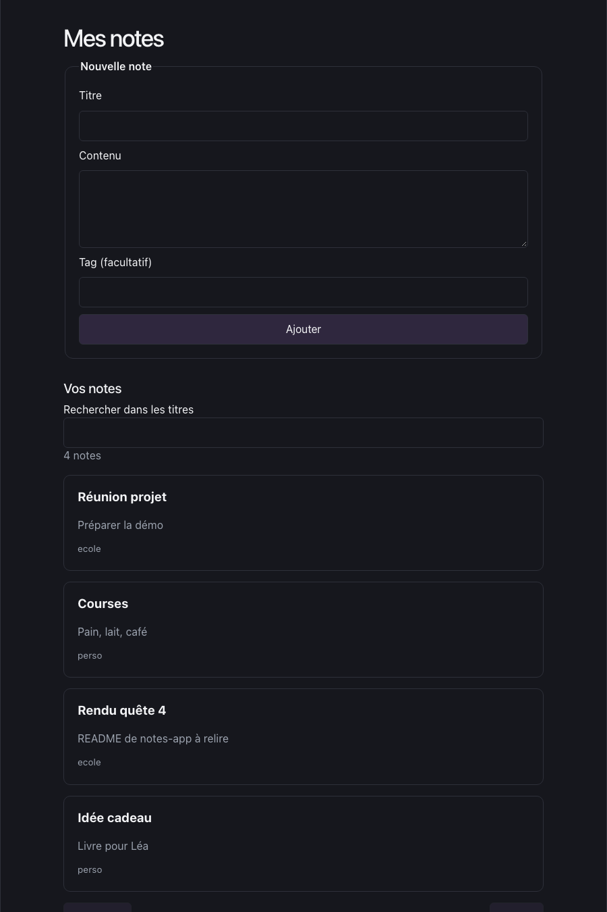
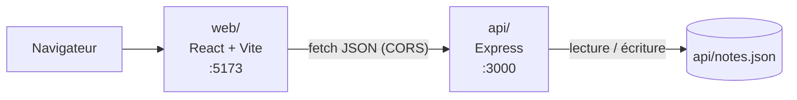

# notes-app

Application de prise de notes : une API Node.js/Express qui enregistre les notes dans un fichier JSON, et une interface React (Vite) pour les créer, les rechercher et les parcourir.

Projet pédagogique du module « Travail collaboratif et documentation technique », prévu pour un usage local.

## Prérequis

- Node.js 22.12 ou plus récent (la CI utilise Node.js 24)
- npm (installé avec Node.js)
- Git

## Installation

Le dépôt est privé : il faut en être collaborateur pour le cloner.

```bash
git clone https://github.com/Cromca/notes-app.git
cd notes-app
```

Dans un premier terminal, depuis la racine du dépôt, lancer l'API :

```bash
cd api
npm ci
npm start
```

L'API affiche `API sur http://127.0.0.1:3000` et écoute sur http://localhost:3000.

Dans un second terminal, ouvert à la racine du dépôt `notes-app`, lancer le front :

```bash
cd web
npm ci
npm run dev
```

Vite affiche l'adresse du front, habituellement http://localhost:5173. Si le port 5173 est déjà pris, Vite en choisit un autre : l'API refusera alors les requêtes du front, voir `CORS_ORIGINS` dans la configuration.

## Configuration

Toutes les variables sont facultatives.

| Variable | Partie | Rôle | Valeur par défaut |
| --- | --- | --- | --- |
| `PORT` | api | Port d'écoute de l'API | `3000` |
| `HOST` | api | Interface d'écoute de l'API | `127.0.0.1` (machine locale uniquement) |
| `NOTES_FILE` | api | Fichier où les notes sont enregistrées | `api/notes.json` (exclu de Git) |
| `CORS_ORIGINS` | api | Origines web autorisées, séparées par des virgules, sans chemin. Remplace la liste par défaut ; `*` est refusé | `http://localhost:5173`, `http://127.0.0.1:5173`, `http://localhost:4173`, `http://127.0.0.1:4173` |
| `VITE_API_URL` | web | Adresse de l'API, lue au démarrage de Vite ou à la compilation | `http://localhost:3000` |

Exemple si Vite démarre sur le port 5177, à exécuter dans `api/` après avoir arrêté l'API. Sous Bash (Linux, macOS ou Git Bash) :

```bash
CORS_ORIGINS=http://localhost:5177,http://127.0.0.1:5177 npm start
```

Sous PowerShell (Windows) :

```powershell
$env:CORS_ORIGINS = 'http://localhost:5177,http://127.0.0.1:5177'
npm start
```

## Usage

### Interface



- Saisir un titre, un contenu et éventuellement un tag, puis choisir **Ajouter**. Le titre est obligatoire (160 caractères au plus).
- Si l'enregistrement échoue, le brouillon reste dans le formulaire et un message explique le problème.
- La liste affiche dix notes par page, avec les boutons **Précédent** et **Suivant**.
- La recherche porte sur tous les titres et ignore la casse.
- Le contenu des notes est affiché comme du texte : le HTML saisi n'est pas interprété.

### API

| Méthode | Route | Description |
| --- | --- | --- |
| `POST` | `/notes` | Crée une note. `title` obligatoire (1 à 160 caractères), `body` facultatif (20 000 au plus), `tag` facultatif (50 au plus) |
| `GET` | `/notes?page=1` | Liste paginée, dix notes par page. Le nombre total de notes est dans l'en-tête `X-Total-Count` |
| `GET` | `/notes/by-tag/<tag>` | Notes dont le tag correspond exactement |
| `GET` | `/search?q=<texte>` | Recherche dans tous les titres, sans tenir compte de la casse. `q` ne doit pas être vide |
| `DELETE` | `/notes/<id>` | Supprime une note : `204`, ou `404` si l'identifiant n'existe pas |

Les exemples ci-dessous utilisent Bash (Linux, macOS ou Git Bash sous Windows) et ont été exécutés sur une API neuve ; seuls les en-têtes utiles sont reproduits. L'identifiant (`id`) est un UUID généré à la création, le vôtre sera différent : remplacer celui de l'exemple de suppression par l'identifiant reçu lors de la création.

Créer une note :

```bash
curl -i -X POST localhost:3000/notes \
  -H "Content-Type: application/json" \
  -d '{"title": "Courses", "body": "Pain, lait", "tag": "perso"}'
```

```text
HTTP/1.1 201 Created
X-Total-Count: 1

{"id":"967b160a-2966-47a5-b623-02d8bfc79639","title":"Courses","body":"Pain, lait","tag":"perso"}
```

Lister la première page :

```bash
curl -i "localhost:3000/notes?page=1"
```

```text
HTTP/1.1 200 OK
X-Total-Count: 1

[{"id":"967b160a-2966-47a5-b623-02d8bfc79639","title":"Courses","body":"Pain, lait","tag":"perso"}]
```

Filtrer par tag, puis rechercher dans les titres :

```bash
curl localhost:3000/notes/by-tag/perso
curl "localhost:3000/search?q=courses"
```

```text
[{"id":"967b160a-2966-47a5-b623-02d8bfc79639","title":"Courses","body":"Pain, lait","tag":"perso"}]
```

Supprimer une note :

```bash
curl -i -X DELETE localhost:3000/notes/967b160a-2966-47a5-b623-02d8bfc79639
```

```text
HTTP/1.1 204 No Content
```

Les erreurs sont renvoyées en JSON, avec une clé `error` :

```bash
curl -i -X POST localhost:3000/notes -H "Content-Type: application/json" -d '{"body": "sans titre"}'
```

```text
HTTP/1.1 400 Bad Request

{"error":"Le titre doit contenir entre 1 et 160 caractères."}
```

Les principaux codes sont `400` (donnée invalide, par exemple `?page=0`), `403` (origine web non autorisée), `404` (note ou route inconnue) et `413` (requête trop volumineuse).

## Architecture



Le projet est un seul dépôt, en deux parties qui se lancent séparément :

- `api/` : l'API Express. `app.js` définit les routes et les validations, `store.js` lit et écrit le fichier de notes, `server.js` lit la configuration et démarre le serveur.
- `web/` : l'interface React. `src/App.jsx` contient l'écran, `src/api.js` les appels HTTP vers l'API.
- Les notes sont enregistrées dans un fichier JSON (`api/notes.json`), exclu de Git. Il n'y a pas de base de données.

```text
notes-app/
├── api/
│   ├── app.js          routes Express, validation, CORS, erreurs JSON
│   ├── store.js        lecture et écriture du fichier de notes
│   ├── server.js       configuration (PORT, HOST, NOTES_FILE, CORS_ORIGINS) et démarrage
│   └── test/           tests de l'API
├── web/
│   ├── src/App.jsx     interface
│   ├── src/api.js      client HTTP
│   └── src/App.test.jsx
├── docs/img/           captures utilisées dans ce README
├── .github/            modèles d'issue et de pull request, workflow de CI
├── CONTRIBUTING.md     règles de travail de l'équipe
└── README.md
```

Quelques choix de conception, utiles avant de modifier le code :

- Les écritures sont mises en file dans le processus de l'API, et le fichier est remplacé en une fois à partir d'un fichier temporaire. Plusieurs requêtes simultanées ne perdent donc pas de notes.
- Un fichier de notes corrompu renvoie une erreur `500` sans être écrasé.
- Les nouvelles notes reçoivent un UUID. Les anciens identifiants numériques restent pris en charge, et les doublons historiques ne sont pas réécrits.
- Les origines web autorisées sont limitées par `CORS_ORIGINS`. Cette restriction ne remplace pas une authentification : l'application n'en a pas et n'est pas faite pour être exposée sur Internet. L'API n'écoute que sur la machine locale par défaut.
- Un seul processus API doit utiliser un même fichier de notes.

Les raisons de ces choix et les alternatives étudiées sont détaillées dans les [décisions d'architecture](docs/adr/README.md) : [stockage JSON (ADR-0001)](docs/adr/0001-stockage-fichier-json.md) et [pagination (ADR-0002)](docs/adr/0002-pagination-par-numero-de-page.md).

## Tests

Exécuter chaque bloc depuis la racine du dépôt, dans des terminaux distincts (ou revenir à la racine entre les deux).

```bash
cd api
npm ci
npm test
```

```bash
cd web
npm ci
npm test
npm run lint
npm run build
```

Les tests utilisent des fichiers de données temporaires et ne touchent pas à `api/notes.json`. La même série de commandes tourne en CI à chaque pull request (`.github/workflows/checks.yml`).

## Contribuer

Aucun push direct sur `main`. Chaque changement suit le même circuit :

1. une issue décrit le problème ou le besoin (modèle dans `.github/ISSUE_TEMPLATE/`) ;
2. une branche dédiée (`fix/…`, `feat/…`, `docs/…`, `refactor/…`) avec le numéro de l'issue ;
3. une pull request remplie avec le modèle `.github/pull_request_template.md`, avec `Closes #<numéro>` ;
4. au moins une approbation d'un autre membre de l'équipe ;
5. merge en squash, puis suppression de la branche.

Les règles complètes sont dans [CONTRIBUTING.md](CONTRIBUTING.md). Une pull request qui change le comportement du code met à jour ce README dans la même PR.

## Licence

Aucune licence de distribution n'est définie pour le moment. Le dépôt reste privé ; le choix d'une licence est reporté par l'équipe.
