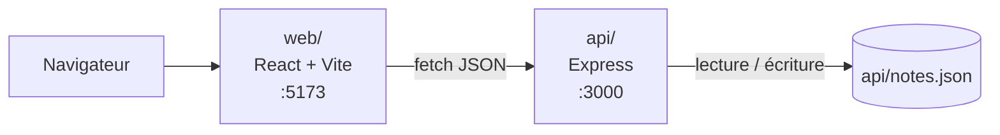

# notes-app

Application de prise de notes : une API Node.js/Express et une interface React/Vite.
Projet pédagogique du module « Travail collaboratif & documentation technique » (Ynov), réalisé en équipe de trois.


## Prérequis

- Node.js 22.12 ou plus récent (la CI utilise Node.js 24)
- npm (installé avec Node.js)
- Git

## Installation

```sh
git clone https://github.com/Cromca/collaborative-notes-app.git
cd collaborative-notes-app
```

L'API et le front se lancent séparément, chacun dans son terminal. Lancer l'API en premier.

Premier terminal, l'API :

```sh
cd api
npm ci
npm start
```

L'API écoute sur http://localhost:3000 (le terminal affiche `API sur http://127.0.0.1:3000`).

Second terminal, depuis la racine du dépôt `collaborative-notes-app`, le front :

```sh
cd web
npm ci
npm run dev
```

Le front est servi sur http://localhost:5173. Ouvrir cette adresse dans le navigateur.

Les notes sont enregistrées dans `api/notes.json`. Le fichier est créé au premier ajout et il est exclu de Git.

## Configuration

Aucune configuration n'est nécessaire pour un lancement local. Les variables suivantes existent si besoin :

| Variable | Partie | Rôle | Défaut |
| --- | --- | --- | --- |
| `PORT` | api | Port d'écoute de l'API | `3000` |
| `HOST` | api | Interface d'écoute | `127.0.0.1` |
| `NOTES_FILE` | api | Fichier de stockage des notes | `api/notes.json` |
| `CORS_ORIGINS` | api | Origines web autorisées, séparées par des virgules | `http://localhost:5173`, `http://127.0.0.1:5173`, `http://localhost:4173`, `http://127.0.0.1:4173` |
| `VITE_API_URL` | web | Adresse de l'API, lue au démarrage de Vite ou à la compilation | `http://localhost:3000` |

Si Vite démarre sur un autre port (5173 déjà pris), il faut autoriser ce port côté API puis la redémarrer :

```sh
CORS_ORIGINS=http://localhost:5177,http://127.0.0.1:5177 npm start
```

Sous PowerShell (Windows) :

```powershell
$env:CORS_ORIGINS = 'http://localhost:5177,http://127.0.0.1:5177'
npm start
```

`CORS_ORIGINS` remplace la liste par défaut. `*` et les adresses avec un chemin sont refusés. Les appels sans en-tête `Origin` (curl, scripts) restent autorisés.

L'application n'a pas d'authentification : elle est prévue pour un usage local, avec un seul processus API par fichier de notes.

## Usage

### Depuis le front

- Saisir un titre, un contenu et un tag facultatif, puis cliquer sur **Ajouter**.
- Si l'enregistrement échoue, le brouillon reste dans le formulaire et un message explique le problème.
- La liste affiche dix notes par page. Le champ de recherche filtre sur les titres, sans tenir compte des majuscules.
- Le contenu des notes est affiché comme du texte, même s'il contient du HTML.

### Routes de l'API

| Méthode | Route | Description |
| --- | --- | --- |
| POST | `/notes` | Crée une note (`title` obligatoire, `body` et `tag` facultatifs) |
| GET | `/notes?page=1` | Liste paginée, 10 notes par page, total dans l'en-tête `X-Total-Count` |
| GET | `/notes/by-tag/<tag>` | Notes dont le tag est exactement `<tag>` |
| GET | `/search?q=<texte>` | Recherche dans les titres, insensible à la casse |
| DELETE | `/notes/<id>` | Supprime une note |

Les exemples ci-dessous ont été lancés sur une API vide. Les identifiants sont des UUID générés à la création, ils seront différents chez vous.

Créer une note :

```sh
curl -i -X POST http://localhost:3000/notes \
  -H "Content-Type: application/json" \
  -d '{"title": "Courses", "body": "Pain, lait", "tag": "perso"}'
```

```text
HTTP/1.1 201 Created
X-Total-Count: 1

{"id":"655d8cf1-12af-4505-848b-fbca3958ab96","title":"Courses","body":"Pain, lait","tag":"perso"}
```

Créer une seconde note :

```sh
curl -X POST http://localhost:3000/notes \
  -H "Content-Type: application/json" \
  -d '{"title": "Réunion projet", "body": "Préparer la démo", "tag": "ecole"}'
```

```text
{"id":"aaa9490d-ed62-4db9-86dd-547e88fa5ebd","title":"Réunion projet","body":"Préparer la démo","tag":"ecole"}
```

Lister les notes :

```sh
curl -i "http://localhost:3000/notes?page=1"
```

```text
HTTP/1.1 200 OK
X-Total-Count: 2

[{"id":"655d8cf1-12af-4505-848b-fbca3958ab96","title":"Courses","body":"Pain, lait","tag":"perso"},{"id":"aaa9490d-ed62-4db9-86dd-547e88fa5ebd","title":"Réunion projet","body":"Préparer la démo","tag":"ecole"}]
```

Filtrer par tag :

```sh
curl http://localhost:3000/notes/by-tag/perso
```

```text
[{"id":"655d8cf1-12af-4505-848b-fbca3958ab96","title":"Courses","body":"Pain, lait","tag":"perso"}]
```

Rechercher dans les titres :

```sh
curl "http://localhost:3000/search?q=cour"
```

```text
[{"id":"655d8cf1-12af-4505-848b-fbca3958ab96","title":"Courses","body":"Pain, lait","tag":"perso"}]
```

Supprimer une note (remplacer l'identifiant par celui renvoyé à la création) :

```sh
curl -i -X DELETE http://localhost:3000/notes/655d8cf1-12af-4505-848b-fbca3958ab96
```

```text
HTTP/1.1 204 No Content
```

### Erreurs

Les erreurs sont renvoyées en JSON, avec un champ `error` :

| Cas | Réponse |
| --- | --- |
| `POST /notes` avec un titre vide ou de plus de 160 caractères | `400` `{"error":"Le titre doit contenir entre 1 et 160 caractères."}` |
| `GET /notes?page=0` (page qui n'est pas un entier ≥ 1) | `400` `{"error":"page doit être un entier supérieur ou égal à 1"}` |
| `GET /search` sans `q` ou avec un `q` vide | `400` `{"error":"q doit être un texte de recherche non vide."}` |
| `DELETE /notes/<id>` avec un identifiant inconnu | `404` `{"error":"Note introuvable."}` |
| Appel depuis une origine web non autorisée | `403` |
| Fichier `notes.json` illisible ou corrompu | `500`, le fichier n'est pas écrasé |

Limites : `body` 20 000 caractères maximum, `tag` 50 caractères maximum, corps de requête 100 ko maximum.

## Architecture



Le projet contient deux parties indépendantes, chacune avec son `package.json` :

- `web/` : l'interface React. `src/App.jsx` contient le formulaire, la recherche et la liste ; `src/api.js` regroupe les appels à l'API.
- `api/` : l'API Express. `server.js` lit la configuration et démarre le serveur, `app.js` déclare les routes et la validation, `store.js` lit et écrit le fichier JSON.
- Les écritures passent l'une après l'autre dans le processus API. Chaque écriture passe par un fichier temporaire, renommé seulement une fois complet, pour ne jamais laisser un `notes.json` à moitié écrit.

```text
.
├── api/          API Express (routes, stockage, tests)
├── web/          Front React/Vite
├── docs/img/     Captures utilisées dans la documentation
└── .github/      Modèles d'issue et de PR, CI
```

Les décisions d'architecture (stockage des notes, pagination…) sont documentées dans [docs/adr/](docs/adr/) : contexte, options envisagées, décision et conséquences.

## Tests

```sh
cd api
npm test
```

```sh
cd web
npm test
npm run lint
npm run build
```

Les tests de l'API démarrent un serveur sur un port libre avec un fichier de notes temporaire. Les tests du front utilisent jsdom et des réponses simulées. La CI GitHub Actions lance ces mêmes commandes sur chaque pull request.

## Contribuer

Le workflow de l'équipe (issues, branches, pull requests, review, merge) est décrit dans [CONTRIBUTING.md](CONTRIBUTING.md).

Qui fait quoi dans l'équipe (matrice RACI) et où trouver chaque information : [docs/equipe.md](docs/equipe.md).

## Licence et auteurs

Aucune licence de distribution n'est définie pour le moment : le choix est reporté par l'équipe.

Équipe : Hugo ([@H129hj](https://github.com/H129hj)), Quentin ([@Cromca](https://github.com/Cromca)), Mohand ([@Mohand-123](https://github.com/Mohand-123)).
